# SemanticFlow Milestone 5.1 Final Research Audit and Consolidated Evaluation Report

## 1. Abstract

Milestone 5.1 evaluated named-question multi-decision batching as a physical operator for LLM-powered semantic AND queries. The full lifecycle comprised an 810-request pilot, a 3,000-request selection experiment, and a preregistered 10,800-request held-out evaluation over three datasets and nine workloads. The held-out matrix reconciles exactly to 3,847,687 input tokens, 528,800 output tokens, 20,000 named decisions, and $0.161602854 under the frozen experimental price. Full batching was cheaper than `existing_adaptive` in two workloads and costlier in seven. The selected Banking77 batch saved 7.90% with a positive paired interval, but failed the unchanged quality gate after one false negative among only three separate-reference positives. Consequently the frozen policy did not establish a quality-admissible improvement. A Beauty workload exposed the converse error: batching was cheaper and passed the point-estimate gate on held-out data, but selection evidence had correctly recorded a quality failure. The audit also identifies a material analysis defect: the historical Stage D cost “predictions” were computed from held-out costs and selectivities, so the reported MAE is retrospective, not out-of-sample. A pre-Stage-D estimator projection is reconstructed separately and labeled as such. One duplicated quality row is a reporting-only defect and is corrected in versioned artifacts.

## 2. Research problem and motivation

SemanticFlow seeks to reduce the monetary and request cost of semantic queries without silently changing their results. Separate early-rejecting execution saves work when early predicates are selective; batching shares record and protocol tokens but evaluates every named question. The research problem is therefore conditional: batching can win only when shared-token savings exceed the loss of early rejection, and any economic gain must survive a semantic-consistency constraint.

## 3. Related system ideas and research positioning

The implementation combines database-style predicate ordering, selectivity estimation, physical-plan enumeration, adaptive profiling, confidence/risk controls, and LLM request batching. This report makes no novelty claim beyond the measured SemanticFlow system. Separate Jev calls are treated as a consistency reference, not human truth. Existing project literature notes are retained where documented; no unverified external citation is introduced here.

## 4. SemanticFlow optimizer architecture

The system separates logical predicates from physical groups. A `FusedOperator` binds predicate IDs, question names, prompt hash, response schema, model, threshold, and execution parameters. A physical plan is an ordered list of groups. The executor advances a record only when every named decision in the current group passes. The selection layer compares fixed separate, adaptive separate, full batch, and selective-first hybrid candidates under cost and quality rules.

## 5. Physical execution strategies

- **Existing adaptive:** frozen separate-predicate order with early rejection.
- **Full multi-decision batch:** one request per record containing every named predicate question.
- **Selective-first hybrid:** one selective group first, followed by a remainder batch only for surviving records.
- **Conjunctive binary (Milestone 5):** one binary conjunction question; retained as a historical negative control.

## 6. Cost model and early-rejection equations

For ordered groups $G_1,\ldots,G_k$ over $N$ records, the estimator used

$$\widehat C = N\sum_{i=1}^k \left(\prod_{j<i}\widehat s_j\right)\bar c_i,$$

where $\widehat s_j$ is an unconditional group pass rate and $\bar c_i$ is mean group request cost. Actual replay instead sums measured per-record costs only along the reached path:

$$C_\text{replay}=\sum_r\sum_{i:\,r\text{ reaches }i} c_{ri}.$$

Costs use $0.042 per million input tokens and $0 per output token. They are experimental proxies, not invoices.

## 7. Adaptive profiling and physical-plan selection

The baseline controller used frozen selection-stage measurements and a ten-execution horizon. Selection compared 111 catalog plans but Stage D measured a frozen 29-plan union supporting the declared strategies. The selected quality-constrained policy changed only m51_banking_card_unauthorized_refund; all other workloads retained `existing_adaptive`.

## 8. Quality-gate design

The unchanged gate required at least 40 records, at least three separate-reference positives, agreement at least 0.98, recall at least 0.95, FNR at most 0.05, changed-decision rate at most 0.02, and complete real evidence. It is a point-estimate consistency gate. It does not require the Wilson lower bound for recall to exceed 0.95 and does not establish human-label accuracy.

## 9. Experimental datasets and workloads

Amazon All Beauty, Banking77 queries, and SMS Spam each contributed 400 evaluation records. Nine two-, three-, and four-predicate AND workloads were evaluated. Manifest validation confirmed development, pilot, selection, and evaluation identity sets were disjoint.

## 10. Jev model and execution configuration

All successful Stage D traces resolved to `jev-1.14.0`, threshold 0.5, cache disabled, concurrency four, and no retry. The frozen schedule contained 6,000 single-reference calls, 3,600 full-batch calls, and 1,200 remainder-batch calls. Four smoke requests were schedule members, not additions.

## 11. Experimental timeline

1. Milestone 5 tested conjunctive-binary fusion.
2. M5.1 Stage B tested named-question batching.
3. Stage C analyzed batching and selective-first hybrids offline.
4. The selection stage acquired 3,000 physical measurements and froze nine decisions.
5. Stage D independently acquired 10,800 evaluation-partition measurements.
6. This audit replays only persisted evidence and makes zero provider calls.

## 12. Milestone 5 baseline findings

The conjunctive pilot made 1,230 requests and cost $0.018939564. Full conjunction fusion was 21.77% more expensive than fixed separate replay; 472/480 decisions agreed with the separate conjunction, but no tested candidate passed the frozen quality gate. This remains a negative result.

## 13. Milestone 5.1 pilot results

Stage B completed 810 requests, 1,380 named evaluations, 299,406 input tokens, 37,690 output tokens, and $0.012575052. Stage C found workload-dependent two-question benefits, approximate three-question aggregate parity, frequent four-question losses, and exploratory hybrid gains, but incomplete coverage and no quality-qualified candidate.

## 14. Selection-stage results

The selection stage reconciles 3,000 successful physical requests, 3,300 logical roles, 300 aliases, 5,300 named evaluations, 1,064,824 input tokens, and $0.044722608. Three pre-response transport attempts remain in the ledger with unknown billing. Banking77 Card/Unauthorized/Refund was selected after a 7.34% measured selection saving and 100/100 query agreement with three positives. Beauty failure/usability was rejected because its selection batch had recall 7/8 (87.5%) and FNR 1/8 (12.5%), failing the unchanged gate.

## 15. Independent held-out results

| Workload | Adaptive | Full batch | Batch saving | Saving % | Batch quality | Frozen selected |
|---|---|---|---|---|---|---|
| beauty failure usability | $0.006665442 | $0.006385470 | $0.000279972 | 4.20% | passed | separate |
| beauty reaction packaging refund | $0.006016626 | $0.007040670 | $-0.001024044 | -17.02% | insufficient_positive_support | separate |
| beauty reaction failure value return | $0.006088824 | $0.007645470 | $-0.001556646 | -25.57% | insufficient_positive_support | separate |
| banking unauthorized refund | $0.005578566 | $0.005886426 | $-0.000307860 | -5.52% | failed | separate |
| banking card unauthorized refund | $0.007138908 | $0.006575226 | $0.000563682 | 7.90% | failed | full_batch |
| banking withdrawal unauthorized refund access | $0.005972316 | $0.007230426 | $-0.001258110 | -21.07% | insufficient_positive_support | separate |
| sms prize contact | $0.005610066 | $0.005773950 | $-0.000163884 | -2.92% | passed | separate |
| sms prize urgency contact | $0.005764836 | $0.006227550 | $-0.000462714 | -8.03% | passed | separate |
| sms security prize urgency contact | $0.005303550 | $0.006798750 | $-0.001495200 | -28.19% | insufficient_positive_support | separate |

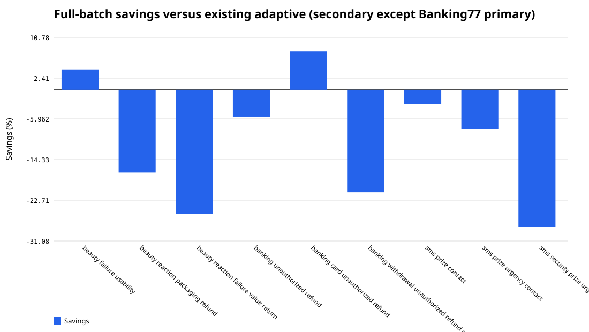

The aggregate 400-record-per-workload modeled costs are $0.054139134 for existing adaptive, $0.059563938 for full batching, and $0.053575452 for the realized frozen selected strategy. These modeled costs are not the $0.161602854 matrix acquisition expense.

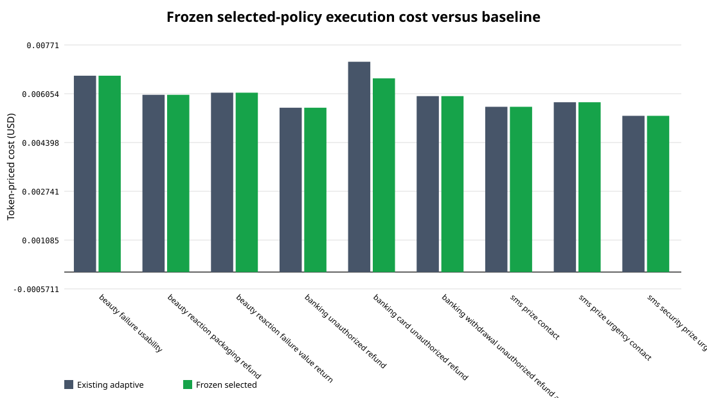

## 16. Full batching versus existing adaptive

Full batching was cheaper only for Beauty failure/usability and the Banking77 primary. It was costlier for the other seven workloads. This pattern supports the central mechanism: batching benefits shared token overhead, while early rejection dominates when the first predicate filters enough records or the batch prompt grows substantially.

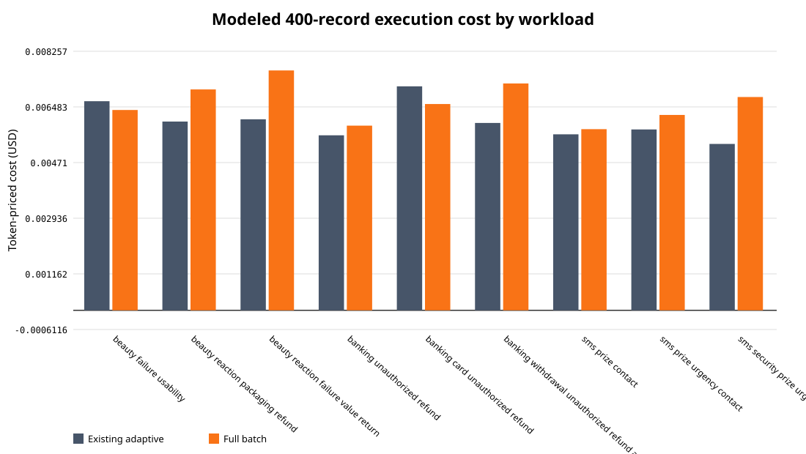

The physical-request matrix also exposes the batch-size/token relationship. The plot is descriptive across the frozen operator mix; it does not isolate batch size causally because datasets, prompts, and predicates differ.

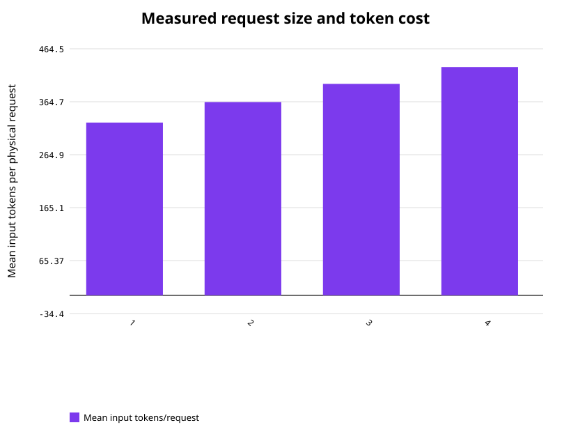

## 17. Hybrid execution performance

Selective-first hybrids were measured where a unique remainder group existed. Some reduced cost relative to a full batch, but the bounded measured union does not establish global plan optimality. A “correct fallback” against full batching can still have post-hoc regret relative to another separate order or hybrid. All such comparisons are secondary and share records and operators.

| Workload | Hybrid plan | Observed cost | vs adaptive | Quality |
|---|---|---|---|---|
| beauty reaction failure value return | m51selplan_1da909ec76b171c5051279d2 | $0.006055938 | $0.000032886 | insufficient_positive_support |
| beauty reaction packaging refund | m51selplan_8bbcea50734015c3688db762 | $0.006036282 | $-0.000019656 | insufficient_positive_support |
| banking card unauthorized refund | m51selplan_a692dd47d27a86fcac221b71 | $0.007222488 | $-0.000083580 | failed |
| sms prize urgency contact | m51selplan_c3f0fb3deb77072fedd6e947 | $0.005742156 | $0.000022680 | passed |
| sms security prize urgency contact | m51selplan_e3d9de8978cee5b7efc32588 | $0.005303550 | $0.000000000 | insufficient_positive_support |
| banking withdrawal unauthorized refund access | m51selplan_e8ec97774a90a7e131cf42e3 | $0.006133722 | $-0.000161406 | insufficient_positive_support |

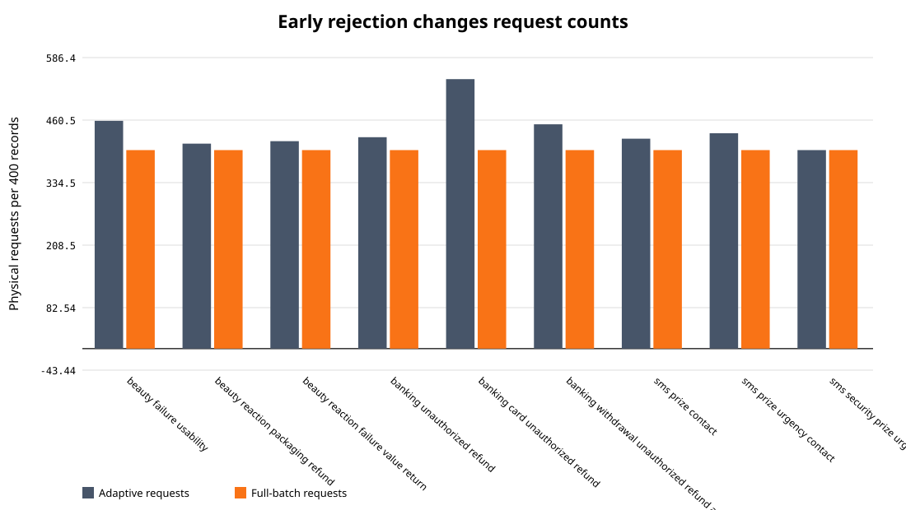

## 18. Banking77 primary case study

The primary batch cost $0.006575226 versus $0.007138908, saving $0.000563682 (7.90%). The paired 10,000-draw record bootstrap interval was [$0.000294084, $0.000845754]. Economically, batching won on the held-out sample.

Quality did not. Query decisions matched 399/400. There were three separate-reference positives, two true positives, one false negative, and no false positives: recall 66.67%, FNR 33.33%, agreement 99.75%. The disagreement record was `banking77_queries:79b1defb8d3744eecffa7361`. Its predicate probabilities were `[{"batch_decision": true, "batch_probability": 0.72, "predicate_id": "banking_card_related", "separate_decision": true, "separate_probability": 0.72, "threshold": 0.5}, {"batch_decision": false, "batch_probability": 0.49, "predicate_id": "banking_unauthorized_activity", "separate_decision": true, "separate_probability": 0.5, "threshold": 0.5}, {"batch_decision": true, "batch_probability": 0.67, "predicate_id": "banking_refund_or_reversal", "separate_decision": true, "separate_probability": 0.69, "threshold": 0.5}]`. This is a threshold-crossing inconsistency relative to separate Jev inference, not proof of human-label error. The final primary classification is **economic success, quality failure**.

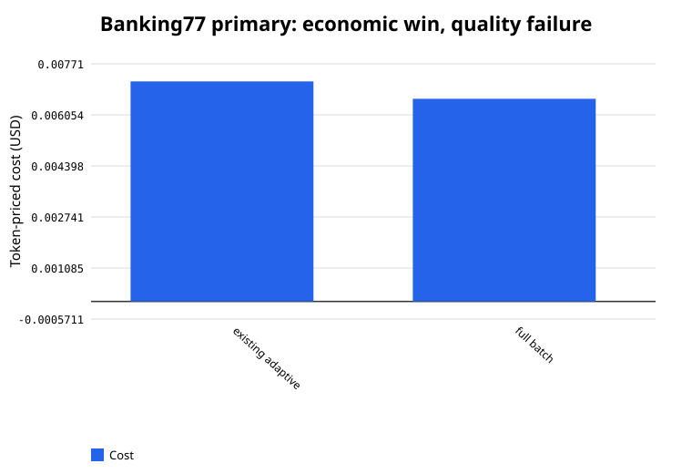

## 19. Beauty missed-opportunity case study

Beauty full batching cost $0.006385470 versus $0.006665442, saving $0.000279972 (4.20%). Its paired interval [$0.000085932, $0.000481866] was wholly positive. It matched 398/400 with 22 positives, 21 TP, one FP, one FN, recall 95.45%, and FNR 4.55%; it passed the frozen point-estimate gate.

The original fallback was nevertheless justified by the permitted selection evidence: the selection batch failed recall and FNR at 7/8. Held-out results make it excessively conservative in hindsight and expose quality-estimation uncertainty, not evidence that the optimizer could safely have selected it prospectively. The post-hoc quality-constrained oracle regret is $0.000279972 per 400-record execution.

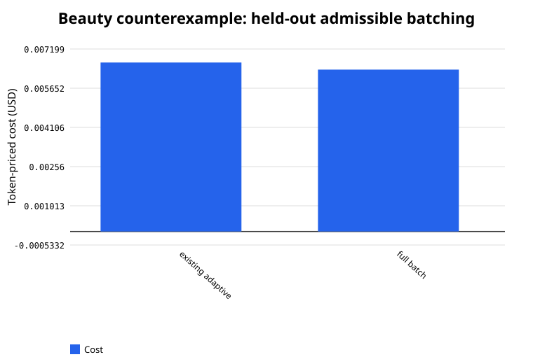

## 20. Semantic-quality analysis

| Workload | Positives | TP | FP | FN | Agreement | Recall | FNR | Status |
|---|---|---|---|---|---|---|---|---|
| beauty failure usability | 22 | 21 | 1 | 1 | 99.50% | 95.45% | 4.55% | passed |
| beauty reaction packaging refund | 0 | 0 | 0 | 0 | 100.00% | undefined | undefined | insufficient_positive_support |
| beauty reaction failure value return | 0 | 0 | 0 | 0 | 100.00% | undefined | undefined | insufficient_positive_support |
| banking unauthorized refund | 8 | 7 | 1 | 1 | 99.50% | 87.50% | 12.50% | failed |
| banking card unauthorized refund | 3 | 2 | 0 | 1 | 99.75% | 66.67% | 33.33% | failed |
| banking withdrawal unauthorized refund access | 0 | 0 | 0 | 0 | 100.00% | undefined | undefined | insufficient_positive_support |
| sms prize contact | 21 | 21 | 1 | 0 | 99.75% | 100.00% | 0.00% | passed |
| sms prize urgency contact | 11 | 11 | 0 | 0 | 100.00% | 100.00% | 0.00% | passed |
| sms security prize urgency contact | 0 | 0 | 0 | 0 | 100.00% | undefined | undefined | insufficient_positive_support |

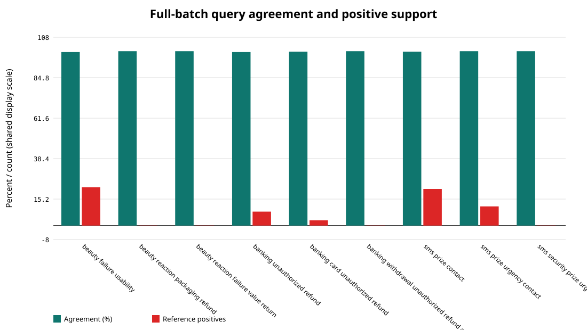

The canonical original reporting view has 17 rows and 17 unique plan IDs, versus 18 rows in the historical artifact. The duplicate Banking77 row was byte-for-byte identical evidence appended under both full-batch and selected-plan roles. It did not cause duplicate inference or weighting.

## 21. Sparse-positive limitations

Four full-batch workloads had zero positive complete-query references and therefore undefined recall; they remain `insufficient_positive_support`. Banking77 primary had exactly three, the minimum, so one disagreement drove recall to 2/3. Perfect or near-perfect overall agreement in a rare-positive AND query cannot substitute for supported positive-class recall.

## 22. Cost-estimator provenance audit

The historical Stage D analyzer calls `predict_plan` with held-out IDs and the held-out lookup. Thus every group mean cost and selectivity comes from evaluation data. For a one-group batch, predicted cost is exactly $N\times\bar c=\sum c_r$, explaining all nine exact matches. The historical MAE of approximately $0.000022485 is therefore a **held-out-informed retrospective diagnostic**, not an independent forecast.

A corrected validation projects the pre-Stage-D persisted 100-record selection predictions to 400 records using the estimator's linear $N$ form. Those inputs reproduce exactly without Stage D information, but the 400-record projection itself was reconstructed after the fact and was not persisted as a Stage D forecast. Its all-plan MAE is $0.000142848; its full-batch MAE is $0.000056490; mean within-workload pairwise concordance is 0.898. This is the defensible out-of-sample diagnostic, with the stated provenance limitation.

## 23. Plan-selection regret

Seven frozen fallback decisions correctly rejected full batching, one Beauty fallback was excessively conservative in hindsight, and the selected Banking77 batch was not confirmed because quality failed. Quality-constrained measured-set oracle regret sums to $0.001391082. This is post-hoc oracle regret within 29 measured plans; it is neither prospective optimizer performance nor global regret.

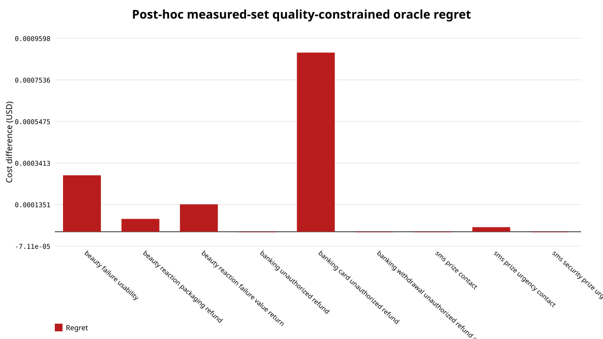

## 24. Profiling economics

Banking77 execution saving was $0.000563682 per 400-record run. Standalone profiling cost $0.007067130 and breaks even after 13 executions excluding unmetered optimization; shared statistics cost $0.002967972 and break even after 6; warm start has immediate positive API-token economics. At one execution, standalone net benefit is $-0.006503448 and shared net benefit is $-0.002404290. Every Banking77 row is marked **QUALITY_INADMISSIBLE_ON_HELD_OUT**; these savings cannot support deployment.

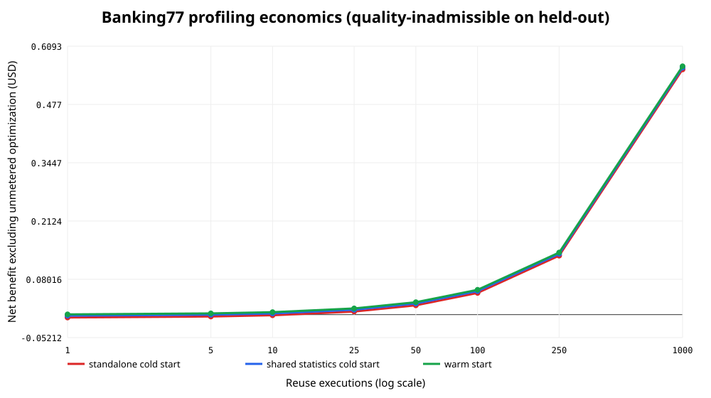

## 25. Statistical uncertainty

The audit reproduced every stored interval with exact record alignment, seed 51103, and 10,000 paired record-cluster draws. The SMS four-predicate interval is genuinely degenerate: every record has the same paired cost difference, so every bootstrap resample sums to the same statistic. It is not an aggregate-resampling bug. Intervals are nominal and unadjusted; only Banking77 was preregistered as primary. Shared records, predicates, and physical requests make secondary comparisons dependent.

## 26. Full expenditure accounting

| Experiment | Requests | Input tokens | Output tokens | Cost proxy |
|---|---|---|---|---|
| M5 conjunctive-fusion live pilot | 1230 | 450942 | 36000 | $0.018939564 |
| M5.1 Stage B named-question batching pilot | 810 | 299406 | 37690 | $0.012575052 |
| M5.1 selection stage | 3000 | 1064824 | 142700 | $0.044722608 |
| M5.1 Stage D held-out matrix | 10800 | 3847687 | 528800 | $0.161602854 |

The four completed live experiments sum to $0.237840078. This is not a complete project spend or provider invoice. Six failed pre-response attempts across selection and Stage D have unknown provider billing, and local optimization/engineering costs are unmetered.

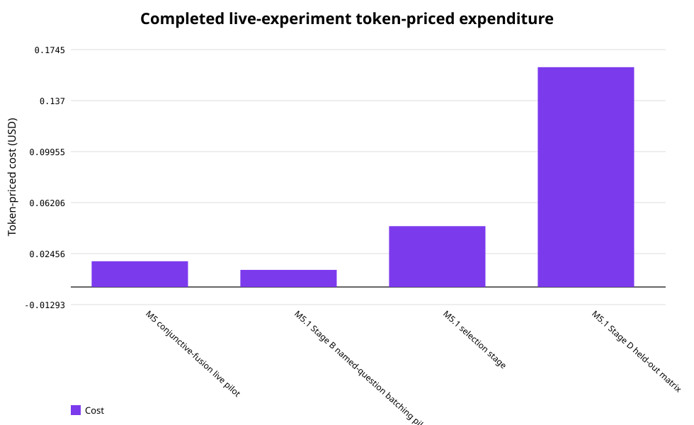

## 27. Threats to validity

- Separate Jev inference is a consistency reference, not human ground truth.
- Positive AND outcomes are sparse; recall intervals remain wide (Beauty 21/22 Wilson lower bound 78.20%).
- There are only three datasets and nine dependent workloads.
- The experiment does not measure identical-request repeatability.
- The plan union is bounded and excludes unmeasured theoretical plans.
- Monetary values are token-price proxies, not invoices.
- Secondary intervals are not multiplicity-adjusted.
- Ex-ante Stage D forecasts were not explicitly persisted; corrected projections are reconstructed from frozen pre-Stage-D inputs.

## 28. Negative findings

Full batching usually lost to early rejection. The sole selected batch failed held-out quality. Four workloads could not certify positive-class behavior. The optimizer missed one admissible opportunity in hindsight. Profiling expense can dominate small per-run savings. The historical estimator artifact leaked held-out measurements into “prediction,” and provider consistency does not establish semantic truth.

## 29. Lessons from implementation

First-class named-question batching and strict response validation worked at scale: 10,800 requests completed without retry. Fingerprinted schedules, immutable plan catalogs, alias deduplication, and fail-closed authorization made the experiment auditable. Derived analyses require equally strict provenance: predictions need explicit information cutoffs, and result rows need evidence identities rather than strategy-role append semantics.

## 30. Research conclusions

Milestone 5.1 established that named-question batching is operationally feasible and economically workload dependent. It did not establish that the current quality-constrained selector generalizes, nor that it delivers a deployable improvement over `existing_adaptive`. The strongest empirical result is the paired combination of a Banking77 economic win with a semantic-consistency failure and a Beauty economic/quality win that selection rejected. Together they show that rare-positive quality qualification—not merely cost modeling—is the dominant unresolved problem.

## 31. Future research directions

| Rank | Direction | Failure connection | Novelty potential | Experimental value | Implementation | Data need | Provider cost | Repeat-work risk |
|---|---|---|---|---|---|---|---|---|
| 1 | Uncertainty-aware quality qualification | Point recall was unstable under rare positives | High if tied to plan admission rather than generic interval reporting | Highest | Medium | Positive-enriched selection/evaluation partitions | Medium | Medium |
| 2 | Active semantic profiling | Uniform samples spent heavily while finding few complete-query positives | High for plan-specific information acquisition | Highest | Medium-high | Unlabeled pool plus safeguarded evaluation split | Medium; targeted | Medium |
| 3 | Human-ground-truth validation | Current reference is Jev consistency, not truth | Moderate; established method, new role in this system | High | High | Independently annotated stratified sample | Low provider / high annotation | Low |
| 4 | Quality-aware plan selection | Cost-only gains can be semantically inadmissible | Medium-high when uncertainty enters the physical objective | High | Medium-high | Calibrated disagreement-risk estimates | Medium | Medium |
| 5 | Distribution-shift robustness | Selection-to-held-out quality did not generalize | High in combination with semantic-plan qualification | High | High | Multiple temporal/domain partitions | High | Medium |
| 6 | More efficient amortized profiling | Break-even is 6 or 13 runs before quality | Medium; overlaps active sampling | Medium | Medium | Reusable operator statistics | Low-medium | High unless distinguished from active profiling |
| 7 | Correlation-aware hybrid cost estimation | Unconditional reach products limit hybrid forecasts | Medium | Medium | Medium | Conditional reach labels | Medium | High because correlation-aware estimation is already partly studied |

The recommended Milestone 5.2 hypothesis is: **an uncertainty-aware, actively sampled semantic qualification procedure can reduce paid profiling while lowering the probability of selecting a batch whose held-out recall violates the frozen threshold.** The experiment should preregister a risk criterion (for example, a lower confidence or posterior bound), acquire informative positive/near-threshold records without reading final evaluation outcomes, compare against uniform profiling at equal cost, and include independent human annotations for a subset. This is a proposal only; no M5.2 implementation or inference occurred.

## 32. Reproducibility appendix

- Branch: `milestone-4.5-calibration`; HEAD: `71b2d8a8bc32353dc61cb208d4907474abe62287`.
- Stage D schedule fingerprint: `6d6fc867d221c9ce1ac29011d0410558b939df842563a5d3116816401f1139f6`.
- Source session: `results/milestone_5_1/stage_d_live_v3`.
- Corrected artifacts: `results/milestone_5_1/final_research_audit`.
- Audit generator: `src/semanticflow/optimizer/m51_final_audit.py`.
- Command: `.\\.venv\\Scripts\\python.exe scripts\\run_m51_final_audit.py`.
- No provider was initialized and no Jev call was made.
- Historical result artifacts were read-only and all manifest-covered fingerprints matched.

## 33. Explicit scientific verdict

### Research Question 1 — Does multi-decision batching reduce cost?

- **Observed evidence:** Two of nine full batches were cheaper; seven were costlier.
- **Quantitative result:** Banking77 saved 7.90%; Beauty saved 4.20%.
- **Interpretation:** Benefits are workload dependent and trade shared overhead against early rejection.
- **Limitation:** Nine dependent workloads do not establish a general population rate.
- **Conclusion:** Yes in limited conditions; no as a general replacement.

### Research Question 2 — Do selective-first hybrids add meaningful gains?

- **Observed evidence:** Some measured hybrids improved on full batching or a frozen selection, but not uniformly.
- **Quantitative result:** Effects are reported per measured plan in `per_workload_verified.csv` and regret artifacts.
- **Interpretation:** Hybrids can restore early rejection while sharing downstream tokens.
- **Limitation:** Only frozen remainder groups were measured.
- **Conclusion:** Promising secondarily, not established as a general gain.

### Research Question 3 — Can the optimizer predict batching costs reliably?

- **Observed evidence:** Historical Stage D “predictions” used Stage D measurements; corrected pre-Stage-D projections have nonzero error.
- **Quantitative result:** Corrected full-batch MAE $0.000056490.
- **Interpretation:** The historical MAE cannot support out-of-sample accuracy.
- **Limitation:** Corrected scaling was reconstructed rather than preregistered as a Stage D forecast.
- **Conclusion:** Reliability is not yet established strongly enough for a general claim.

### Research Question 4 — Does quality-constrained selection generalize?

- **Observed evidence:** The only selected batch passed selection quality and failed held-out quality; one rejected batch passed held-out.
- **Quantitative result:** Banking recall fell from 3/3 to 2/3; Beauty rose from 7/8 to 21/22.
- **Interpretation:** Sparse-positive qualification was unstable across partitions.
- **Limitation:** Counts are small and separate Jev is not truth.
- **Conclusion:** No, generalization was not demonstrated.

### Research Question 5 — Did the frozen policy achieve a quality-admissible net improvement?

- **Observed evidence:** Execution cost fell, but the changed plan failed recall/FNR.
- **Quantitative result:** Aggregate execution-only saving $0.000563682; primary recall 66.67%.
- **Interpretation:** Economic and quality outcomes disagree.
- **Limitation:** Quality is measured as Jev consistency.
- **Conclusion:** No.

### Research Question 6 — How much opportunity did conservative fallback miss?

- **Observed evidence:** One of eight fallbacks was excessively conservative in hindsight.
- **Quantitative result:** Beauty missed $0.000279972 per 400 records; total measured-set quality-constrained oracle regret $0.001391082.
- **Interpretation:** Conservatism avoided many losses but missed one admissible held-out opportunity.
- **Limitation:** This is post-hoc oracle hindsight.
- **Conclusion:** Small absolute measured-set regret, scientifically important selection uncertainty.

### Research Question 7 — Are profiling expenses justified?

- **Observed evidence:** Banking savings break even after 13 standalone or 6 shared executions.
- **Quantitative result:** Warm-start API economics are immediately positive.
- **Interpretation:** Amortization can work at reuse, but only for an admissible plan.
- **Limitation:** Optimization cost is unmetered and Banking quality failed.
- **Conclusion:** Not justified for this selected plan; potentially justified for future qualified plans.

### Research Question 8 — Strongest limitations

- **Observed evidence:** Sparse positives, three datasets, dependent comparisons, no human labels, bounded plan union.
- **Quantitative result:** Four full batches had zero positive references; primary had three.
- **Interpretation:** Quality uncertainty dominates.
- **Limitation:** The experiment was designed for consistency and economics, not truth labels or distribution shift.
- **Conclusion:** Claims must remain narrow and conditional.

### Research Question 9 — Most defensible contribution

- **Observed evidence:** A complete fingerprinted multi-decision execution/selection/evaluation pipeline and real held-out measurements.
- **Quantitative result:** 10,800 Stage D requests and 20,000 named evaluations reconciled exactly.
- **Interpretation:** The system exposes the coupled economics/quality trade-off with reproducible evidence.
- **Limitation:** It does not yet solve reliable qualification.
- **Conclusion:** The contribution is empirical infrastructure and the finding that batching suitability is workload- and quality-dependent.

### Research Question 10 — What should Milestone 5.2 investigate?

- **Observed evidence:** Both the harmful selection and missed opportunity arise from unstable rare-positive quality estimates.
- **Quantitative result:** Selection/held-out recall changed 100%→66.7% for Banking and 87.5%→95.45% for Beauty.
- **Interpretation:** Active, uncertainty-aware quality profiling directly targets the observed failure.
- **Limitation:** It will require new preregistration, annotations, and paid inference.
- **Conclusion:** Test whether active uncertainty-aware qualification improves held-out recall safety per profiling dollar.
