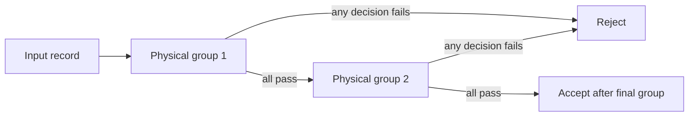

# Milestone 5.1 hybrid architecture

## Physical operators

SemanticFlow now represents three distinct one-request operators:

- `single`: one named predicate and one decision.
- `conjunctive_binary`: one composite question and one group decision.
- `multi_decision`: multiple independently named questions and one returned decision per name.

`FusedOperator` remains the provider-independent request contract. Milestone 5.1 adds a
complete request fingerprint binding question names and ordering, exact instructions, dataset,
model, threshold, provider settings, and result schema. Jev's adapter submits every named
question in one HTTP request and now rejects missing, duplicate-by-construction, unexpected, or
extra answer names. Probabilities outside [0, 1] remain invalid.

## Execution

A batch has no early rejection inside its request. It preserves every named probability and
computes the group pass by AND. Early rejection occurs between groups. Thus `[P1] [P2,P3,P4]`
can avoid the batch when P1 fails, while `[P1,P2,P3,P4]` cannot.

The executor separately reports physical group decisions, named-question evaluations, HTTP
attempts, token usage, inference latency, wall time, retries, errors, and final records. A
partial batch is an incomplete group. Optional fallback is a second explicit execution with a
separate authorization flag and attempt budget; its requests and tokens are added, never hidden.

## Physical planning

Ordered set partitions define group boundaries. Multi-predicate groups then receive every
supported mode assignment. With both conjunctive and multi-decision modes, the candidate counts
are 4 for two predicates, 20 for three, and 138 for four. The original single-mode counts
3/13/75 remain valid only when one multi-predicate mode is enabled.

Every plan covers each logical predicate exactly once. Plan identity includes group membership,
mode, prompt hash, workload, and configuration fingerprint. Unsupported groups cannot enter the
candidate set.

## Cost and quality

Expected plan cost is the sum of per-stage invocation probability times independently measured
group cost. Batch, single, and conjunction statistics are never conflated. Missing later-group
evidence makes a plan incomplete even if an earlier profiling group has zero empirical reach.
The optimizer uses token-priced cost; request count and latency are separate outputs.

Quality evidence is classified as passed, failed, insufficient positives, insufficient total
observations, undefined metric, missing group evidence, missing complete-plan evidence, or
provider failure. Cost-only planning is an ablation. Quality-constrained and profiling-aware
planning require complete-plan real evidence and otherwise fall back to `existing_adaptive`.

## Adaptive profiling and accounting

The deterministic controller ranks unique group measurements by optimistic reuse-horizon value
minus acquisition cost. A measurement can support many plans and is paid once. Limits cover
unique groups, records per group, logical requests, retry-inclusive attempts, and an estimated
cost proxy. Stopping occurs when no positive prospective value remains or any hard request
budget would be violated.

Economic output keeps actual expenditure, standalone acquisition, shared incremental
acquisition, and warm-start projections separate. Mock evidence is never admitted as empirical
provider evidence.

## Reliability

Authorization and all fingerprints are checked before the Jev module is imported. Paid output
directories must not exist; resume fails closed. Each group receives an atomic request budget,
and the fixed schedule mathematically reconciles to the global ceiling. Session state records
incomplete execution and forbids guessed resume behavior.
